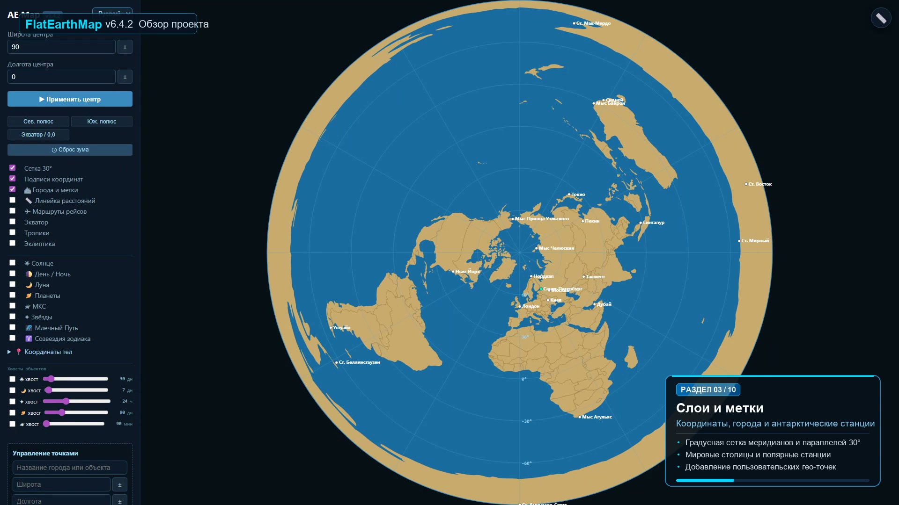

# FlatEarthMap (AE Map) v6.4.2 🌍📐

[](LICENSE)
[](https://developer.mozilla.org/en-US/docs/Web/JavaScript)
[](https://d3js.org/)
[](https://github.com/cosinekitty/astronomy)
[](https://github.com/shashwatak/satellite-js)
[](https://pages.github.com/)

> **Интерактивная гео-астрономическая платформа** для исследования свойств азимутальной эквидистантной проекции Земли (*Azimuthal Equidistant projection*), сравнения моделей плоской и сферической геометрии, а также высокоточного моделирования движения небесных тел и спутников в реальном времени.



---

## 🎬 Видеопрезентация проекта

В репозиторий включена полная **6-минутная Full HD видеопрезентация** с живой озвучкой, атмосферным музыкальным фоном, инфографикой и пошаговым разбором всех возможностей:
* 🎥 **Файл видео:** [`assets/presentation.mp4`](assets/presentation.mp4) *(1920×1080 Full HD, H.264 / AAC)*
* 🌐 **Интерактивный веб-плеер:** откройте [`assets/player.html`](assets/player.html) в браузере для просмотра с быстрой навигацией по таймкодам глав.

---

## 🚀 Ключевые возможности

### 1. 📐 Динамический центр азимутальной проекции
* **Северный полюс (90° N, 0° E):** классическая полярная карта Глисона 1892 года.
* **Южный полюс (-90° S, 0° E):** инвертированная проекция — Антарктида оказывается в центре, а Евразия и Америка растягиваются в гигантские периферийные кольца.
* **Экватор (0° N, 0° E):** поперечная азимутальная проекция.
* **Произвольный центр:** возможность отцентрировать карту на любом городе мира по точным координатам широты и долготы.

### 2. 📏 Интерактивная линейка расстояний (Сфера vs Плоскость)
* Магнитный захват курсора к городам и небесным телам в радиусе 25px.
* Одновременный расчёт двух величин:
  1. **Реальная сферическая ортодромия** по формулам геодезии ($d_{\text{sphere}} = R \cdot c$).
  2. **Плоское евклидово расстояние** на карте ($d_{\text{AE}}$).
* Наглядная демонстрация колоссальных краевых искажений в южном полушарии (на маршруте Сидней — Сантьяго расстояние на плоской карте вырастает с 11 350 км до более чем 25 600 км!).

### 3. ✈ Трансконтинентальные авиарейсы южного полушария
* Нанесение регулярных беспосадочных рейсов:
  * **QF27 (Сидней → Сантьяго)** — Qantas / LATAM (~12.5 часов)
  * **QF63 (Сидней → Йоханнесбург)** — Qantas (~14 часов)
  * **SA221 (Сан-Паулу → Йоханнесбург)** — South African Airways (~8.5 часов)
  * **LA800 (Окленд → Буэнос-Айрес)** — LATAM (~11.5 часов)
* Интерактивные карточки с прямым сравнением сферической и плоской дистанций.

### 4. ☀ Астрономический движок и затмения
* Расчёт подсолнечной и подлунной точек в реальном времени с учётом склонения и прямого восхождения на базе **Astronomy Engine v2**.
* Реалистичная тень терминатора «день / ночь» и динамические фазы Луны.
* **Предиктор затмений:** алгоритмический расчёт и мгновенный перенос симуляции к дате ближайшего солнечного или лунного затмения.

### 5. 🪐 Небесная сфера, Зодиак и Млечный Путь
* 5 планет солнечной системы: Меркурий, Венера, Марс, Юпитер, Сатурн с отображением ретроградных петель.
* 13 зодиакальных созвездий с официальными границами Международного астрономического союза (IAU), включая Змееносец (*Ophiuchus*).
* Звёзды до 5.0 величины и векторные изофоты галактики Млечный Путь.
* Определение текущего созвездия для каждого небесного тела в реальном времени.

### 6. 🛰 Орбитальная баллистика МКС
* Прямая загрузка актуальных двухстрочных элементов TLE NORAD с серверов **CelesTrak**.
* Орбитальный расчёт по баллистической модели **SGP4** через библиотеку **Satellite.js**:
  * Высота орбиты: ~420 км
  * Скорость: ~27 600 км/ч (7.66 км/с)
  * Период обращения: ~92.8 мин
* Симуляция движения по виткам с ускорением ×1, ×10, ×20 и ×100.

### 7. 🌀 Хвосты траекторий и годовые спирали
* Включение истории движения (до 365 дней).
* Анимация с шагом 24 часа демонстрирует, как подсолнечная точка вычерчивает сезонную **спираль между Северным и Южным тропиками**, наглядно объясняя смену времён года.
* Режимы шага: 1 час (суточный), 24 часа (годовой), звёздные сутки (23ч 56м 4с).

---

## 🛠 Технологический стек

Проект реализован по концепции **Vanilla Architecture** без громоздких фреймворков:

```
FlatEarthMap/
├── index.html              # Точка входа веб-приложения (HTML5, SVG)
├── static/
│   ├── config.js           # Конфигурация, города, маршруты, стили, константы
│   ├── state.js            # Управление состоянием, localStorage, URL
│   ├── astro.js            # Астрономические расчёты и баллистика SGP4
│   ├── render.js           # D3.js SVG-визуализатор карты и слоёв
│   ├── main.js             # Контроллеры событий, UI и логика линейки
│   └── style.css           # Тёмная тема, адаптивная верстка
├── data/
│   ├── land.geojson        # Полигоны континентов и островов
│   ├── borders.geojson     # Международные границы государств
│   ├── zodiac.json         # Границы 13 созвездий IAU
│   ├── zodiac-stars.json   # Звёзды до 5.0m и линии созвездий
│   └── milkyway.json       # Изофоты Млечного Пути (d3-celestial)
├── assets/
│   ├── preview.jpg         # Обложка и превью проекта
│   ├── player.html         # Плеер видеопрезентации с главами
│   └── presentation.mp4    # Видеопрезентация Full HD (38 МБ)
├── scripts/                # Скрипты генерации видеопрезентации
│   ├── build_presentation.py
│   ├── generate_audio.py
│   ├── make_ambient.py
│   ├── overlays.py
│   └── requirements.txt
├── .github/workflows/
│   └── pages.yml           # Автодеплой на GitHub Pages
├── .gitignore
├── LICENSE                 # MIT License
└── README.md
```

---

## ⚡ Быстрый запуск локально

Так как проект не требует сборки (Webpack/Vite не нужны), его можно запустить любой локальной утилитой или веб-сервером:

### Вариант 1: Через Python
```bash
python -m http.server 8000
```
Затем откройте в браузере: [`http://localhost:8000`](http://localhost:8000)

### Вариант 2: Через Node.js / npx
```bash
npx serve .
```

### Вариант 3: VS Code Live Server
Нажмите правой кнопкой мыши на `index.html` и выберите **"Open with Live Server"**.

---

## 🌐 Деплой на GitHub Pages

Репозиторий уже содержит готовый GitHub Actions workflow (`.github/workflows/pages.yml`).

1. Создайте новый репозиторий на GitHub (например, `FlatEarthMap`).
2. Привяжите локальный репозиторий и запушьте код:
   ```bash
   git remote add origin https://github.com/ВАШ_ЛОГИН/FlatEarthMap.git
   git branch -M main
   git push -u origin main
   ```
3. В настройках репозитория на GitHub перейдите в **Settings → Pages**.
4. В разделе **Build and deployment → Source** выберите **GitHub Actions**.
5. Через 1–2 минуты сайт автоматически станет доступен по адресу:
   `https://ВАШ_ЛОГИН.github.io/FlatEarthMap/`

---

## 📄 Лицензия

Проект распространяется под открытой лицензией [MIT](LICENSE).
GeoJSON данные: Natural Earth (Public Domain) и d3-celestial (BSD-3-Clause).
